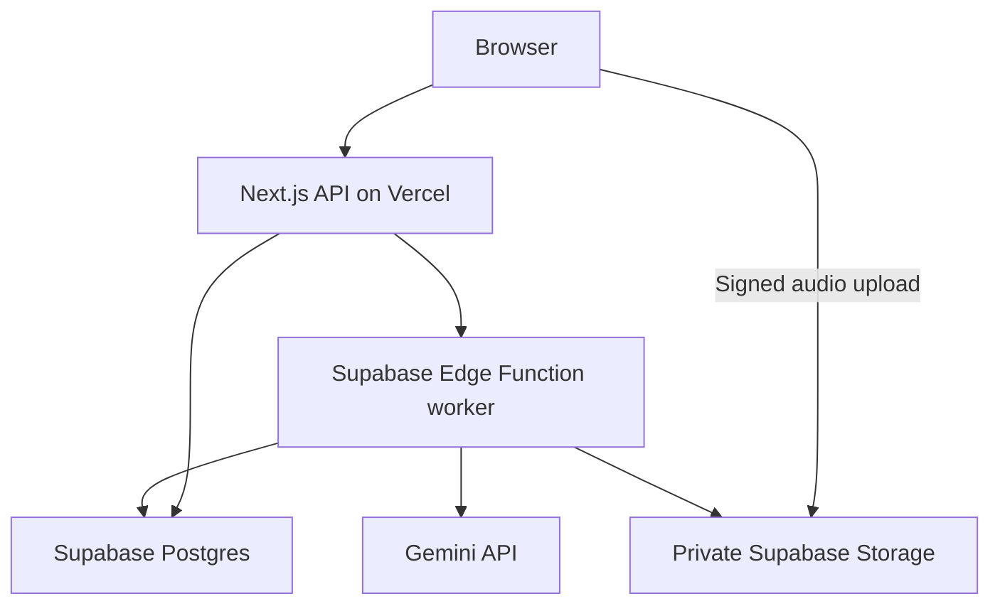

<div align="center">

# 🎧 Podwise

### From audio to insight


🌐 **[Live app](https://podwise-six.vercel.app/)** · 🎬 **[Demo video](https://podwise-six.vercel.app/podwise-demo.mp4)** · 📘 **[Technical notes](docs/TECHNICAL_NOTES.md)**

</div>

**Podwise** is an AI podcast companion. Upload an episode or paste a transcript, and it gives you a **summary, key themes, takeaways, chapters and a quiz**, with every point tied back to an exact quote from the source. 🎙️ ➜ 🧠

I built it for the **Thealon AI Engineering Challenge**. The goal was to make podcasts easy to revisit: find a specific idea without replaying the whole episode, and check that you actually understood it.

---

## ✨ Features

- 🎵 **Audio or text input**: MP3 / WAV / M4A (up to 20 MB and 20 min), or a pasted transcript (with optional `[MM:SS]` timestamps)
- 📝 **AI overview**: summary, themes and key takeaways
- 📚 **Chapters** with descriptions and clickable transcript references
- ❓ **3–5 question quiz** with scoring, answers and explanations
- 🔎 **Source-grounded output**: each claim cites an exact quote, and the app rejects anything it can't find in the transcript
- ✏️ **Targeted revisions**: rewrite only the overview or only the quiz, keep everything else, with a revision trail (up to 10)
- ▶️ **Audio player** that jumps to chapters (audio offsets are clearly marked as AI-estimated)
- 📤 **Export** to Markdown or JSON, copy to clipboard, or print notes
- 🕶️ **No account needed**: private per-browser history, progress tracking and safe retries
- 💸 **Runs on free tiers**: Supabase Free, Vercel Hobby and the Gemini free tier, with rate limits to keep it that way

## 🧠 How it works



1. The browser validates the input, and the API **reserves quota** and creates a job.
2. Audio goes **straight to private Supabase Storage** with a signed upload URL, so big files never pass through the API.
3. A **Supabase Edge Function** runs the work in stages: transcribe → save transcript → analyze.
4. Gemini returns **structured JSON**, and the app checks every quote, chapter and quiz answer before saving.
5. The browser asks for the next stage when the previous one finishes and shows the results as they're ready. If you close the tab mid-way, reopening it picks up where it left off.

Jobs move through clear states (`queued`, `transcribing`, `analyzing`, `completed`, `failed`…). A saved transcript means a failed step can retry without transcribing again.

## 🛠️ Tech stack

| Layer | Tools |
| ----- | ----- |
| Frontend | Next.js 15 (App Router), React 19, TypeScript, Lucide icons |
| API | Next.js route handlers on Vercel |
| Database & storage | Supabase Postgres (RLS, no public grants) + private Storage |
| Background work | Supabase Edge Functions |
| AI | Google Gemini (`gemini-3.5-flash-lite` by default) |
| Testing | Node's built-in test runner |

## 🚀 Run it locally

**Requirements:** Node.js 24 and npm.

```bash
git clone https://github.com/abdullahaljubayer-101/podwise.git
cd podwise
npm ci
cp .env.example .env.local
```

Fill in `.env.local`:

| Variable | Purpose |
| -------- | ------- |
| `SUPABASE_URL` | Your Supabase project URL |
| `SUPABASE_SERVICE_ROLE_KEY` | Server-only service key (never expose it to the browser) |
| `GEMINI_API_KEY` | Gemini API key (server-only) |
| `GEMINI_MODEL` | Optional, defaults to `gemini-3.5-flash-lite` |

Then:

```bash
npm run dev        # http://localhost:3000
npm run build
npm run typecheck
npm test
```

> ⚙️ You'll also need to run `supabase/schema.sql` and deploy the `podwise-worker` Edge Function. The full step-by-step setup is in the [technical notes](docs/TECHNICAL_NOTES.md#supabase-provisioning).

## 🔒 Security and reliability

- No user accounts. Each browser gets a random, unguessable key that is **hashed** before storage, and every request checks ownership.
- Database tables and storage are **closed to public clients**. Uploads and reads use short-lived signed URLs.
- API keys stay on the server. The worker never logs raw transcripts or provider errors.
- Every network call has a timeout. Quota limits, bad input and model errors show clear messages instead of fake results.

## 🧪 Testing

**22 automated tests** cover input validation, timestamps, fabricated evidence, quiz integrity, quota limits, session isolation, CSRF origin checks and signed uploads. The live app was also tested end to end with real audio and transcripts. See [VERIFICATION.md](docs/VERIFICATION.md).

## 🗺️ What I'd add next

1. **Unattended background jobs** (Supabase Queues/Cron or Inngest), so processing continues even after the tab is closed
2. **Better transcription alignment**, comparing a dedicated speech-to-text model and measuring timestamp accuracy
3. **Automatic data cleanup and stronger abuse protection** for the public demo

## 📁 Project structure

```text
podwise/
├── app/
│   ├── page.tsx                  # The whole workspace UI
│   ├── layout.tsx
│   └── api/route.ts              # API: jobs, uploads, revisions, history
├── supabase/
│   ├── schema.sql                # Tables, RLS, private storage
│   └── functions/podwise-worker/ # Edge Function: transcribe + analyze
├── tests/                        # Validation + API tests
└── docs/
    ├── TECHNICAL_NOTES.md        # Research, architecture, debugging, limits, costs
    ├── IMPLEMENTATION_PLAN.md
    └── VERIFICATION.md
```

---

<div align="center">

Made by **Abdullah Al Jubayer** · [GitHub](https://github.com/abdullahaljubayer-101) · [Portfolio](https://abdullahaljubayer.com)

</div>
