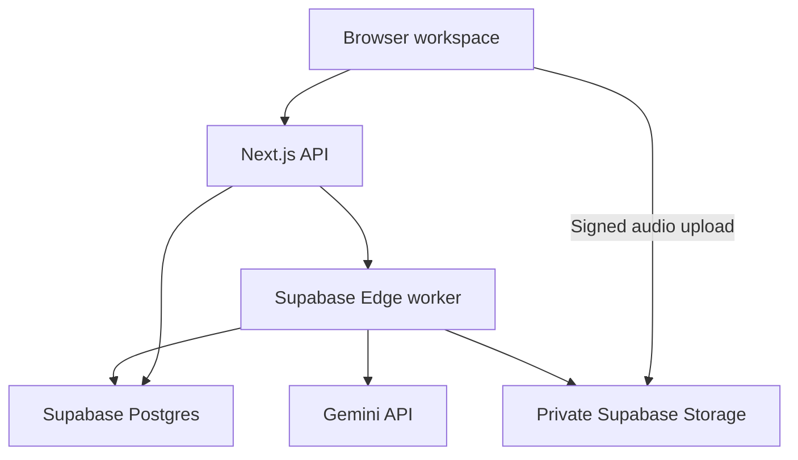

# Podwise — From Audio to Insight

A focused, account-free AI Podcast Companion for the Thealon Animation Studios engineering challenge. No landing page, authentication pages, pricing, payments, or cart.

## Status

The public application is connected to Supabase Free, Vercel Hobby, and the Gemini free tier. Real transcript generation, overview revision, audio upload/transcription/analysis, quiz scoring, source navigation, and Markdown/JSON exports have been exercised on the live application. Temporary provider errors are surfaced; no placeholder output or paid fallback is used.

- [Live app](https://podwise-six.vercel.app/)
- [Source code](https://github.com/abdullahaljubayer-101/podwise)
- Model: `gemini-3.5-flash-lite`, selected after live availability and latency checks.
- [Implementation plan](docs/IMPLEMENTATION_PLAN.md)
- Responsive viewport verification and final demo recording are being finalized; see the verification notes for the exact scope.

## Features and limits

- MP3/WAV/M4A uploads: maximum 20 MB and 20 minutes. Browser checks decoded duration; API validates supplied metadata; provider errors reject unreadable recordings. Content permission confirmation is required.
- Text transcripts: 100–60,000 characters, with optional `[MM:SS]` or `[HH:MM:SS]` prefixes. Timestamps must be chronological.
- Actual Gemini summary, themes, takeaways, chapter descriptions and 3–5 multiple-choice questions, checked against exact source quotes.
- Navigable transcript references. Original transcript timestamps are preserved. Audio offsets are explicitly **AI-estimated**, not guaranteed alignment. Untimed text never receives invented timestamps.
- Overview/quiz revisions reuse the saved transcript and preserve all unselected sections. Revision trail retained (max 10 revisions).
- Audio player; quiz scoring, answers and explanations; copy, Markdown/JSON downloads, and printable current-section notes.
- Private anonymous browser history, stage progress, safe errors and retries. No account required. Clearing browser storage loses the random capability used to access that browser's history.
- Free-demo limits: 5 processing/revision reservations per browser per hour, 8 per network, 30 globally. No paid provider fallback.

## Local setup

Requires **Node.js 24** and npm.

```sh
npm ci
cp .env.example .env.local
# Set the server-only variables described below.
npm run dev
```

Open http://localhost:3000.

```sh
npm run build
npm test
```

Tests exercise input/output validation and the compiled Next.js API with mocked external services. They do not prove actual Gemini, Supabase, or browser behavior.

### Server-only configuration

| Variable | Purpose |
| --- | --- |
| `SUPABASE_URL` | Supabase project API URL |
| `SUPABASE_SERVICE_ROLE_KEY` | Server-only legacy service key; never expose through NEXT_PUBLIC variables |
| `GEMINI_API_KEY` | Free-tier Gemini API key, server-only |
| `GEMINI_MODEL` | Optional; defaults to `gemini-3.5-flash-lite`, tested with the project free quota |

Do not print or commit secret values. Set them in Vercel's encrypted environment variables for deployment. Do not enable billing.

### Supabase provisioning

1. Create the `podwise` project in the selected **Free** organization.
2. Run `supabase/schema.sql` as the project owner. Tables have RLS and no anon/authenticated grants; storage is private with no public policies.
3. Deploy the `podwise-worker` Edge Function from `supabase/functions/podwise-worker/index.ts` with `core.ts` included.
4. Set the custom Supabase Edge Function secret `PODWISE_SERVER_KEY` to the same service-role credential configured in Vercel. This avoids reliance on an implicit default credential differing between worker and dashboard. Never commit its value.
5. Disable gateway JWT verification **only for this worker**: its handler verifies the internal bearer credential against `PODWISE_SERVER_KEY` (with a legacy environment fallback) before any database/model operation. The browser never receives this credential. Supabase provides the project's URL and service-role key to its worker environment.
6. The Next.js server invokes the worker over TLS. Gemini credentials are passed only in the server-to-worker request body, are not logged or saved in job rows, and must not be exposed in request-body logging.
7. Periodically clean old jobs and associated audio objects. Current 24-hour history expiration restricts API access; it does **not** by itself delete stored data.

### Vercel deployment

Import the GitHub repository into the `podwise` project. Use the **Next.js** preset, `npm ci`, `npm run build`, and the **default output directory**. Do not set `out`; the implementation now includes server routes and no longer uses static export. Use the Hobby plan. The production alias above has been tested without Vercel login. Preview URLs may still use deployment protection; leave that protection in place.

## Research and comparison

The target user is a learner or curious listener who wants to retrieve specific ideas and check understanding without replaying an entire episode.

| Approach | Suitability | Integration and reliability | Cost/latency considerations |
| --- | --- | --- | --- |
| Gemini audio understanding + structured generation | One provider can transcribe audio and generate episode analysis | Schema-constrained JSON plus application checks. Generative timestamps can drift; citations verify quotes but cannot prove every interpretation | Available free quota is required; two audio stages plus one model request per revision. Must test actual model access and time per stage |
| OpenAI speech-to-text + text generation | Dedicated transcription followed by separate analysis | Separate integrations; timestamp support depends on transcription model/format. Still requires source grounding and output checks | Paid API usage is not enabled for this zero-budget project; an alternative if approved credits become available |

Gemini is the selected choice because free quota is a requirement. Model selection is configuration, not an assumption of unlimited or permanent free availability. A permitted 1,401-character structured analysis request to Gemini 3.5 Flash-Lite completed in 18.9 seconds and passed evidence validation in one direct test. This is an observed sample, not a guaranteed or production benchmark. Gemini 2.5 Flash was listed but rejected for this new project; Gemini 3.8 Flash worked but encountered timeouts and 503s during longer tests, so the default was changed.

Official references and design implications:
- [Gemini audio understanding](https://ai.google.dev/gemini-api/docs/audio): supports recorded audio and transcription-style prompts; use the Files API for larger recordings.
- [Gemini structured outputs](https://ai.google.dev/gemini-api/docs/structured-output): JSON schemas constrain format, but application validation and factual checks remain necessary.
- [Gemini pricing](https://ai.google.dev/gemini-api/docs/pricing): free-tier access is limited and free content may be used to improve Google products; disclose this before upload.
- [OpenAI speech-to-text](https://platform.openai.com/docs/guides/speech-to-text): an alternative dedicated transcription approach.
- [Supabase background tasks](https://supabase.com/docs/guides/functions/background-tasks): `EdgeRuntime.waitUntil` continues processing after a response; it is still bounded by worker limits.
- [Supabase function limits](https://supabase.com/docs/guides/functions/limits): Free workers have a limited lifetime, so transcription and analysis are separate stages.
- [Vercel function limits](https://vercel.com/docs/functions/limitations): large audio should upload directly to storage.
- [OWASP API Security](https://owasp.org/www-project-api-security/): ownership checks, resource limits and private credentials are required even without user accounts.

## Architecture and background jobs



Flow: validate → reserve quota → save job → direct audio upload if present → transcribe → save transcript → analyze → validate exact evidence and quiz structure → save results → display. Revisions change only the chosen result fields.

States: `awaiting_upload`, `queued`, `transcribing`, `awaiting_analysis`, `analyzing`, `completed`, `revising`, `failed`. Compare-and-set claims and lease IDs prevent simultaneous workers from overwriting a different lease. A stalled worker becomes retryable; a saved transcript avoids repeating transcription.

**Can Supabase replace Inngest here? Yes, for bounded stages.** This implementation uses Supabase background tasks and persisted state, with the browser requesting the next stage. Closing the browser can leave an episode awaiting analysis; reopening resumes it. This is not an unattended durable queue. A scheduled queue worker or Inngest would be appropriate if uninterrupted background continuation or longer recordings were required. Neither is falsely claimed as implemented.

## Reliability and security

- Random, unguessable browser capabilities are hashed before storage; every read/mutation checks ownership. They are not user accounts and must not be shared.
- DB tables and storage are inaccessible to public clients. Signed uploads/read links are scoped and time-limited.
- Evidence must be an exact normalized substring of the cited source segment. Unknown segments, invalid/duplicate quiz choices, out-of-range answer indexes and nonchronological chapter references are rejected.
- Source content is explicitly treated as untrusted data in model instructions. No tool execution or user-provided URLs are sent to arbitrary hosts.
- Network calls have finite timeouts. Free quota failures and malformed/unfinished responses produce explicit errors; no canned results or paid fallback.
- API keys remain server-side. Raw provider errors and source transcripts are not logged by the worker.
- Temporary Gemini uploaded files are deleted in a `finally` block when the worker finishes. A forcibly terminated worker may prevent that cleanup; provider lifecycle limits and project maintenance still matter.

### Known limitations

Generative transcription can omit or mishear speech. Exact evidence checking does not guarantee a summary is a correct interpretation. Audio offsets are estimates; meaningful timestamp reliability must be verified on real recordings. Duration is decoded by the browser and checked as metadata by the server, rather than independently measured with FFmpeg. Session/network quotas can be circumvented by a determined attacker; this is an evaluation app, not a production abuse-control system. Expired database/storage records need scheduled retention cleanup. Supabase may pause inactive free projects. Mobile/tablet viewport tests, playback on physical devices, and long-recording accuracy need separate evaluation; the exact verification scope is documented.

## Debugging examples and verification

1. **Vercel output mismatch:** static `out` configuration with the Next.js preset produced `NEXT_NO_ROUTES_MANIFEST`. Restoring Vercel's default output setting fixed the frontend deployment. The new server build also uses the default output.
2. **Long source truncation:** initial transcript chunking could skip the beginning of a long unbroken paragraph. Replaced regex matching with explicit bounded slicing; added a regression test asserting all 2,800 source characters survive.

3. **Worker credential mismatch:** the first live request saved the transcript but received 403 from the internal worker. A direct authenticated worker request confirmed the mismatch, while decoding only non-secret JWT claims confirmed the server credential belonged to this project. Configured `PODWISE_SERVER_KEY` explicitly in Supabase, retained strict server-only bearer checking, and confirmed successful processing. No public database grant was added.
4. **Model latency and lifecycle:** Gemini 2.5 returned a model-unavailable error despite appearing in discovery; 3.8 generated some results but also timed out or returned 503. Verified free-tier 3.5 Flash-Lite with a grounded structured request, added one bounded retry for transient 5xx/network failures, reduced output budget, and made revision schemas generate only selected fields. Failed revisions preserve the existing result. No paid fallback is enabled.

Current validation: **22 automated tests passed** (8 pure validation tests and 14 mocked API tests), production build and TypeScript checks passed. Tests cover timestamp handling, invalid inputs, fabricated evidence, quiz integrity, quota stopping, session isolation, CSRF origin rejection and signed-upload URL handling. Live tests verified real transcript analysis, shortening an overview from 364 to 152 characters while preserving quiz/chapters/transcript, audio transcription and analysis of an original 75.82-second synthesized recording, chapter seeking and playback, quiz scoring (4/4), history search, and Markdown/JSON exports. Six additional live API checks verified readiness, session rejection, invalid input, CSRF origin rejection and cross-session isolation. Clipboard readback and native print dialogs cannot be fully inspected by the current browser interface; exports provide a verified alternative.

## Cost and maintenance

Use only Supabase Free, Vercel Hobby and an unbilled Gemini project with available free quota. Stop when quotas are exhausted. No payment integration, billing upgrade or paid fallback exists. Review provider quotas/model lifecycle, dependency updates, retention cleanup, failed stages and paused-project status.

## Three prioritized improvements

1. **Unattended durable continuation:** add Supabase Queues/Cron or Inngest once long recordings or closed-tab continuation are needed; avoid jobs waiting for a browser.
2. **Better transcription alignment and evaluation:** compare a dedicated ASR model with generative transcription, measure timestamp/error rates, and evaluate claim grounding on a permitted test corpus.
3. **Retention and stronger abuse protection:** automate storage/job expiry and add provider-level request budgets or challenge-based throttling so public evaluation remains private and inexpensive.

## Final submission checklist

- [x] Focused, responsive, account-free interface implemented.
- [x] Audio/transcript, real provider integration code, chapters, quizzes and targeted revisions implemented.
- [x] Private schema and bounded background worker implemented.
- [x] Research comparison, architecture, setup, debugging notes, costs, limitations and three next improvements documented.
- [x] Build, TypeScript checks and 22 local tests passed.
- [x] Free service provisioning completed; secrets configured.
- [x] Public Vercel production alias verified without sign-in; final source update is being synchronized.
- [x] Actual audio and transcript end-to-end tests passed.
- [ ] Revision, playback, navigation, downloads and responsive browser behavior verified.
- [ ] Actual short demonstration video recorded and linked.
- [ ] Final secrets scan and source/deployment parity confirmed.
